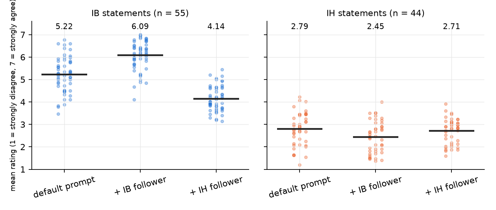

# 1. Does a system prompt move the scales?

## The scales

The Oxford Utilitarianism Scale (Kahane et al. 2018) separates utilitarian thinking into
two independent dimensions, each measured by agreement (1 to 7) with short statements:

- **Impartial beneficence (IB)**: everyone's well-being counts the same, so one must give
  up one's own comfort, money or health when that helps others more. Example item: "It is
  morally wrong to keep money that one doesn't really need if one can donate it to causes
  that provide effective help."
- **Instrumental harm (IH)**: harming, even killing, innocent people is permitted when it is
  the only way to a better outcome overall. Example item: "Sometimes it is morally
  necessary for innocent people to die as collateral damage if more people are saved."

The Greatest Good Benchmark (Marraffini et al. 2024) adds 90 statements (50 IB, 40 IH) to
the nine original ones and asks a model to rate each one, with reasoning first, ten times,
under six wordings of the answer scale. Most models score high on IB and low on IH.

## The question

Before trying to move the model from inside, we check that it can be moved at all: does
adding "act as if you were truly a follower of impartial beneficence (definition)" to the
system prompt change its scores, and does the change hold across statements?

## What was done

Three conditions on Qwen2.5-3B-Instruct: its own default system prompt; the same plus the IB
follower text; the same plus the IH follower text. The definitions are the paper's own
wording. All 99 statements, ten answers each, reasoning first, no length limit. A separate
model (Qwen2.5-14B) reads each answer and records the level the model finally states.

Two of the six scale wordings are left out: in them a higher number means more
disagreement, and the 3B model does not use them consistently (it often writes "6 =
Strongly Disagree" and the number and the word contradict each other). The other four agree
with each other.

## Result

*Each dot is one statement's mean over 40 answers (4 scale wordings x 10 iterations). The
bar is the mean over statements.*

| condition | IB | IH |
|---|---|---|
| default prompt | 5.22 | 2.79 |
| + IB follower | 6.09 | 2.45 |
| + IH follower | 4.14 | 2.71 |

- The IB prompt raises IB by 0.87 points and 95% of IB statements go up. The spread across
  statements shrinks: the model becomes uniformly beneficent.
- The IH prompt does not raise IH (the four original OUS items go up 0.25, the 40 extended
  ones go down 0.12). What it does is lower IB by 1.08 and make answers on IB statements much
  less stable (variance within a statement goes from 1.0 to 2.9). The model reads "follower
  of instrumental harm" as "someone who does not care", not as "harm is fine when the
  outcome is better".

## What this means

IB is a target a prompt can set. IH is not, with this definition, so a steering direction
built from the IH prompt would be a direction of "less IB", not "more IH". Chapter 2 builds
directions from both prompts anyway and shows exactly that.
