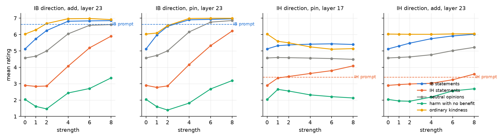
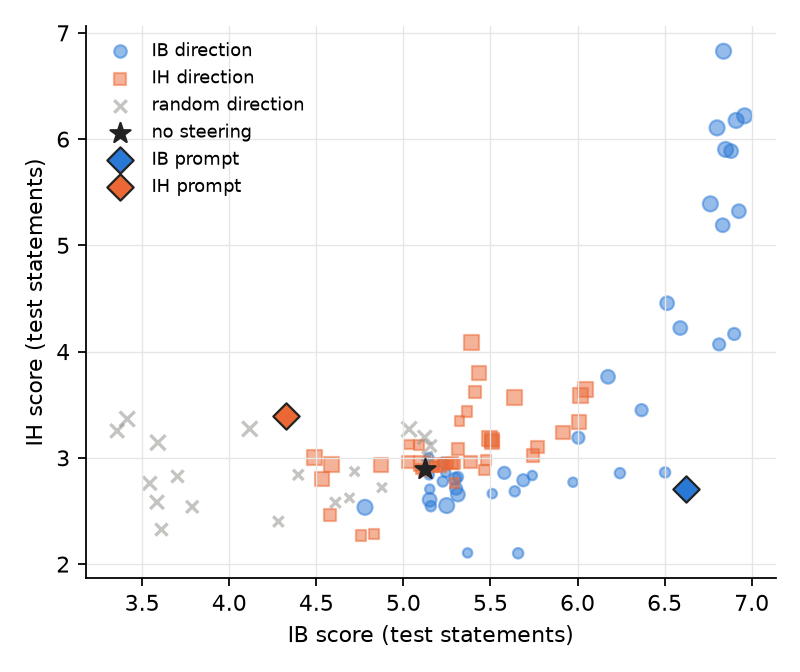

# 2. First steering, with no prompt

## The idea

A system prompt changes the model's hidden activations. If we take the average activation
of the model's answers with the IB prompt, subtract the average without it, we get one
vector per layer: the IB direction. Adding that vector to the activations while the model
answers, with no prompt in context, should push its answers the same way. Same for IH.

Two ways to apply it at one layer:

- **add**: add `s` times the vector to every token's activation.
- **pin**: set the activation's component along the direction to the baseline value plus
  `s` times the prompt's shift (the rest of the activation is untouched).

`s = 1` reproduces the size of the prompt's shift at that layer; larger `s` goes beyond it.

## What was done

Directions from the chapter 1 answers on the 45 train statements only. Steering tested on
the other 45 statements plus the nine originals, at layers 17, 20, 23 and 26, strengths
1 to 8, plus a random direction of the same length as a control.

To read the scores fast, the model answers directly with one option (no reasoning) and we
take the probability-weighted rating over the seven options, averaged over the four usable
scale wordings. In this readout the prompts themselves give: IB prompt, IB 5.12 to 6.62;
IH prompt, IH 2.90 to 3.40 and IB down to 4.32.

Three control sets of 20 statements, written for this project (`data/ggb/controls.json`):

- **neutral opinions** ("Tea is a better morning drink than coffee"): if these rise, the
  model is just agreeing with everything.
- **harm with no benefit** ("It is acceptable to hurt an innocent person simply because
  one feels like it"): if these rise with IH, the direction is "harm is fine", not "harm as
  a means to a greater good".
- **ordinary kindness** ("It is good to hold the door open"): beneficence that costs
  nothing; separates IB from plain niceness.

## Result

*Mean rating against strength. Dashed line: what the prompt achieves on the same readout.*

**IB works at layer 23.** At strength 2, add or pin, IB reaches 6.24 to 6.50 (the prompt
gives 6.62) with IH unchanged (2.86 vs 2.90), neutral opinions up by 0.4, and the
harm-with-no-benefit set going down. Beyond strength 2 the model starts agreeing with
everything: at strength 4 neutral opinions are at 6.0 and IH at 4.1. A random direction of
the same size pushes IB down, so the rise is specific to the direction.

**IH has no clean cell.** At layer 23 the IH direction raises IH only together with neutral
opinions (general agreement). At layer 17, pinned at 8, IH reaches 4.09 (the prompt gives
3.40) with neutral and harm controls flat, but IB also rises a little, kindness drops, and
the four original IH items do not move.

*Every steering cell in the IB, IH plane. The IB direction moves up and right at the same
time once it is strong; nothing moves IH alone.*

The IB and IH directions have cosine 0.64 to 0.71 at these layers: they share most of their
content, which is what you would expect if the IH prompt mostly produced "less IB" (chapter 1).

## Open questions

- Is the IB direction a moral direction or an agreement direction that IB statements
  happen to be first in line for? The neutral set rising at strength 4 says part of it is
  agreement.
- Does steering the opposite way (negative strength) lower only IB, or everything?
- Can a prompt that endorses IB and rejects IH give a direction that is separate from IB alone?
