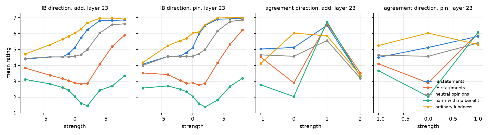
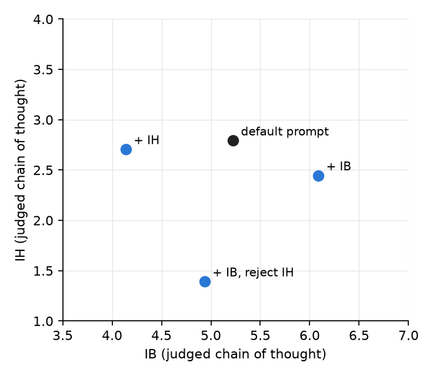

# 3. Is the IB direction just "agree more"?

## The worry

Chapter 2 found that one direction raises IB with little strength, while IH barely moves.
A simpler story would explain that: the direction is "agree with the statement", models
readily agree with beneficence and resist agreeing with harm, so IB rises first and IH
would follow only with more force. Four tests.

## Test 1: compare with a real agreement direction

Build an agreement direction the direct way: the model's activation when it is forced to
answer "Strongly Agree" minus when it is forced to answer "Strongly Disagree", on the
neutral opinions (tea vs coffee), where no moral content is involved.

- Its cosine with the IB direction is 0.06 at layer 23 (0.00 to 0.13 across layers); with
  IH, 0.03. The two are close to orthogonal.
- Steering with it looks nothing like IB steering (figure, right two panels): at strength 1
  every set goes to 6 to 7 at once, including harm with no benefit (6.7). At strength 2 the
  answer is no longer one of the options (the model stops producing a rating).

*Left two panels: the IB direction from strength −8 to +8. Right two: the agreement
direction (cells where the answer is still an option).*

## Test 2: walk the opposite way

Negative strength along the IB direction (left panels) lowers IB (5.1 to 4.1 at −8), lowers
kindness, and raises IH (2.9 to 3.5 to 3.8) and harm with no benefit. Neutral opinions stay
near 4.5. So the far end of the IB direction is not "disagree with everything": it is "care
less about others, accept more harm". The IB direction behaves like a care axis with IH on
its negative side, which fits the cosine of 0.67 between the IB and IH directions and the
IH prompt lowering IB in chapter 1.

## Test 3: line or cloud?

For each prompted answer, take its activation displacement from the unprompted mean and
compare it with the mean direction (layer 23):

| | IB | IH |
|---|---|---|
| cosine with the mean direction, mean ± std | 0.52 ± 0.18 | 0.44 ± 0.11 |
| 10th / 90th percentile of that cosine | 0.28 / 0.72 | 0.28 / 0.57 |
| answers moving the positive way | 99% | 100% |
| component along the line (mean ± std) | 5.3 ± 2.2 | 3.7 ± 1.1 |
| residual off the line, mean length | 8.3 | 7.5 |
| share of displacement variance on the line | 6.5% | 1.9% |

The sign is consistent for nearly every answer, so the mean direction is real. But each
answer sits in a cloud around it that is larger than the shift itself, and the line explains
a few percent of the variance. The prompt moves the model along a line on average and
scatters it everywhere else. Whether that scatter is structured (a manifold) or noise is
the next question; this run does not separate the two.

## Test 4: a prompt that endorses IB and rejects IH

"A follower of impartial beneficence who firmly rejects instrumental harm", with both
definitions, judged chain of thought on all 99 statements.

| condition | IB | IH |
|---|---|---|
| default prompt | 5.19 | 2.77 |
| + IB | 6.05 | 2.44 |
| + IB, reject IH | 4.90 | 1.41 |
| + IH | 4.12 | 2.65 |

The rejection works (IH down on every single IH statement) but IB falls too. The model
becomes a rule-follower across the board, not an IB-only utilitarian. The direction this
prompt produces has cosine 0.86 with the IB direction, and steering with it moves nothing
(IB 5.0 to 5.3 at strengths 1 to 4). Telling the model the two things are independent does
not make them independent in its activations.

## Where this leaves us

- The IB direction is a moral direction, not an agreement direction.
- Its far side is instrumental harm, which is why no prompt or direction so far raises IH
  without lowering IB: in this model the two scales are one axis plus noise.
- The per-answer scatter is large. The next step is to look at its structure: whether
  answers that disagree with the mean direction share a second direction, and whether
  moving within the cloud rather than along the line changes the scores.
