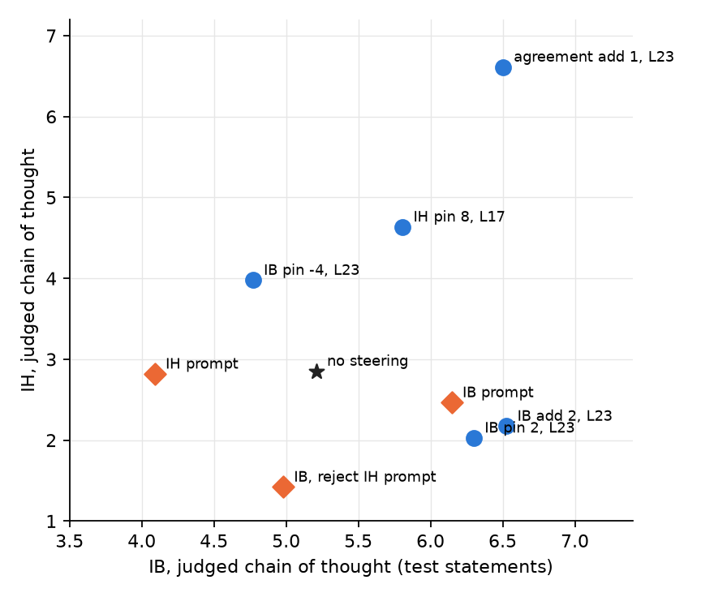
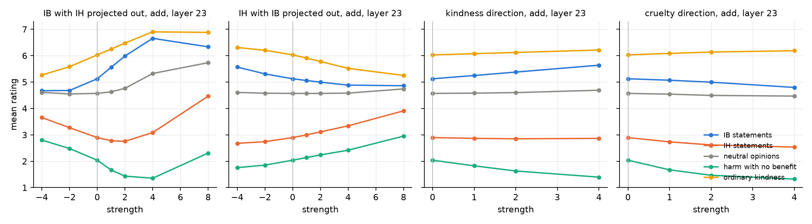

# 4. Chain of thought confirms it, and what it takes to move IH

## Does the fast readout hold under the paper's protocol?

Chapters 2 and 3 scored steering with a direct one-option answer. Here the steered cells
answer with reasoning first, no length limit, ten answers per statement and wording, judged
by the 14B model, exactly as the prompts were scored in chapter 1. Test statements only.

*Each point is a condition. Diamonds are system prompts, circles are steering with the
default prompt.*

| condition | IB | IH | IB statements up | IH statements up |
|---|---|---|---|---|
| no steering | 5.20 | 2.84 | | |
| IB prompt | 6.14 | 2.46 | 97% | 8% |
| IB add 2, layer 23 | 6.52 | 2.16 | 100% | 21% |
| IB pin 2, layer 23 | 6.30 | 2.02 | 100% | 12% |
| IB pin −4, layer 23 | 4.77 | 3.98 | 30% | 100% |
| IH prompt | 4.09 | 2.81 | 7% | 46% |
| IH pin 8, layer 17 | 5.80 | 4.63 | 80% | 96% |
| agreement add 1 | 6.50 | 6.62 | 93% | 100% |

- **Steering IB beats the prompt**: 6.52 against 6.14, on every IB statement, and IH goes
  down, not up. The answers are as stable as the prompted ones.
- **Walking IB backwards is the cleanest way to raise IH** found so far: IH 2.84 to 3.98 on
  100% of IH statements, with low variance, at the cost of 0.4 IB. No prompt achieved this.
- **The layer-17 IH cell is strong but impure**: IH +1.8, but IB +0.6 and the answers are
  unstable (variance 4.0 on IH statements, against 1.7 unsteered). Reading them, the
  model flips between "serves a greater purpose, I agree" and "harming a child is
  impermissible, strongly disagree" on the same statement.
- **Agreement steering** sends both scales to 6.5: the model agrees with everything.

## Can IB and IH be separated by projection?

Take the IH direction and remove its component along IB (and the other way round), then
steer with the remainder at layer 23 (fast readout).

- **IH with IB projected out** raises IH from 2.9 to 3.9 at strength 8 with IB nearly
  flat (−0.3) and neutral opinions flat. But harm with no benefit rises from 2.0 to 3.0 and
  kindness drops. So the part of IH that is not IB is "harm is acceptable", with the
  "for the greater good" part living in the shared component.
- **IB with IH projected out** reaches IB 6.7 at strength 4 with IH at 3.1 and neutral at
  5.3, where the raw IB direction at the same strength had IH 4.1 and neutral 6.0. Removing
  IH makes the IB direction cleaner and lets it go further before tipping into agreement.

## Kindness and cruelty: can they be isolated?

Prompts "a truly kind person" (everyday warmth) and "a truly cruel person" (harm for no
reason). The two directions have cosine 0.74 with each other, the shared "playing a
character" component. Steering with them at layer 23:

- **Kindness** moves IB (+0.5 at strength 4) more than the kindness set (+0.2, which sits
  at 6.0 already) and lowers harm. It is a weak IB direction, not a separate thing.
- **Cruelty** moves almost nothing: IB −0.3, IH −0.4, harm with no benefit down. The cruel
  prompt itself lowers IB to 3.55 and kindness to 4.55 but does not raise harm (1.93): the
  model refuses to endorse pointless harm, prompted or steered. There is no "accept harm
  for its own sake" direction reachable from this prompt.

## Is IB a line, a manifold, or something token-dependent?

From the per-answer activations at layer 23 (300 prompted IB answers): after removing the
component along the IB line, the leading residual direction is 85% between-statement
variance and 1% between-wording, and it has cosine 0.68 with the unprompted answers' own
leading direction. The component along the line also varies by statement (53% of its
variance). So the cloud around the line is the statements, not a persona manifold and not
tokens: the prompt moves every answer along one direction by a statement-dependent amount,
and the rest of the spread is what the model already represents about each dilemma.

## Where this leaves the two scales

In this model IB and IH are not independent axes. The shared component (cosine 0.67) is
"care about outcomes for others", and its negative side is accepting harm. What remains of
IH after removing IB is plain harm acceptance. Three ways to get the model to a chosen
(IB, IH) point that are not yet tried:

1. Two directions at two layers: IB at 23, the orthogonalised IH at 17 or 23, set jointly.
2. Statement-conditional strength: since the effect size is predictable from the baseline
   rating, scale the strength per input instead of using one global value.
3. A direction built from answers that are high on both scales at once (true utilitarian
   answers), if such answers can be elicited at all.
