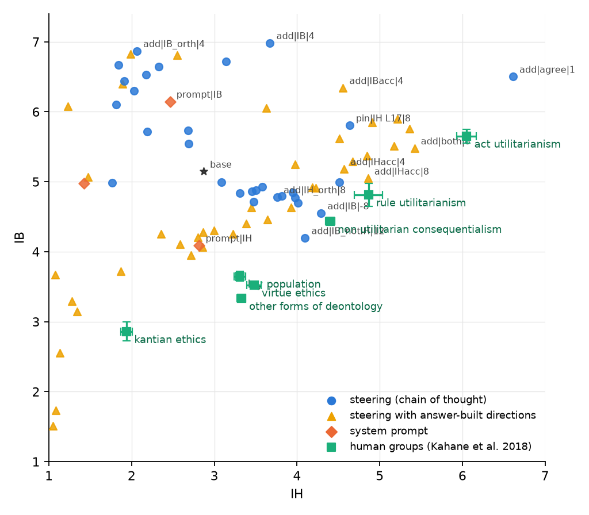

# 5. Where in the IB, IH plane can steering put the model?

## The question

Chapter 4 found that IB and IH share most of one direction. If we steer with the two
directions cleaned of each other (IB with IH projected out, IH with IB projected out),
forward and backward and in combination, what region of the plane do we reach, and does it
contain the positions of the philosopher groups from the Greatest Good Benchmark paper?

## Targets

The group means behind Figure 1 of the paper (IB, IH): act utilitarianism 5.65 / 6.05,
rule utilitarianism 4.81 / 4.86, non-utilitarian consequentialism 4.43 / 4.40, virtue
ethics 3.52 / 3.48, other deontology 3.33 / 3.33, Kantian ethics 2.86 / 1.94, lay
population 3.65 / 3.31.

"Reaching" a group is tested with an equivalence test (two one-sided t tests): the null is
that the model and the group differ by at least 0.5 points on a scale, and a group counts
as reached only when that null is rejected on both scales. Statements are the unit on the
model side.

## What was done

20 steering conditions, all chain of thought, judged by the 14B model, test statements, 4
wordings, 3 iterations: the cleaned IH direction at −8, −4, +4, +8; the cleaned IB
direction at −4, −2, +2, +4; the raw IB direction at −8, −2, +4; and a 3 x 3 grid combining
cleaned IB (−2, 2, 4) with cleaned IH (−4, 4, 8). Plus the 9 conditions of chapter 4.

## Result

*Every chain-of-thought condition (blue), the prompts (orange), the human groups (green,
with standard errors).*

- **The reachable set is a line, not a plane.** Apart from the two cells that tip into
  agreeing with everything (raw IB at +4, the agreement direction), every steered condition
  lies on one band running from (IB 6.9, IH 1.8) to (IB 4.5, IH 4.3): the two scales trade
  off. Cleaning the directions, combining them, going forward or backward: the model moves
  along the band, not off it. Even "IH cleaned of IB" walked backwards raises IB (6.44) and
  lowers IH (1.91).
- **One group is reached in distance, not yet in significance**: raw IB at −8 lands on
  non-utilitarian consequentialism (IB 4.55 / IH 4.29 against 4.43 / 4.40, 0.16 apart).
  The error bars in the source figure are read as standard errors, the stricter choice,
  which gives the group a standard deviation of 1.7 to 2.0; with that spread and N = 36 the
  equivalence test cannot reject a 0.5-point difference (p = 0.13). It would with the
  lenient reading (p < 0.001). Rule utilitarianism is 0.63 away.
- **The utilitarian corner (both high) is only reached by agreement**: the layer-17 IH
  cell (5.81 / 4.64) and the agreement direction (6.50 / 6.61) are the only points above the
  band, and both are impure.
- **The lower-left corner (both low: lay population, virtue, deontology, Kantian) is
  unreached.** No steering condition lowers both scales. The IH prompt gets closest to the
  lay population (0.66 away) by lowering IB without raising IH.

## Reading

With a prompt, the model's answers to this scale move along one axis: more concern for the
greater good at the expense of accepting harm, or the reverse. The human groups are spread
over two dimensions. Everything tried so far, directions, projections and combinations at
one layer, inherits the one axis the prompts gave us. Getting off the band needs a direction
that was never in the prompt contrasts: a "both low" direction (the IB-but-reject-IH prompt
sits at 4.98 / 1.42, below the band, and its direction was not yet pushed hard) and a
"both high" direction built from answers that are high on both scales.
