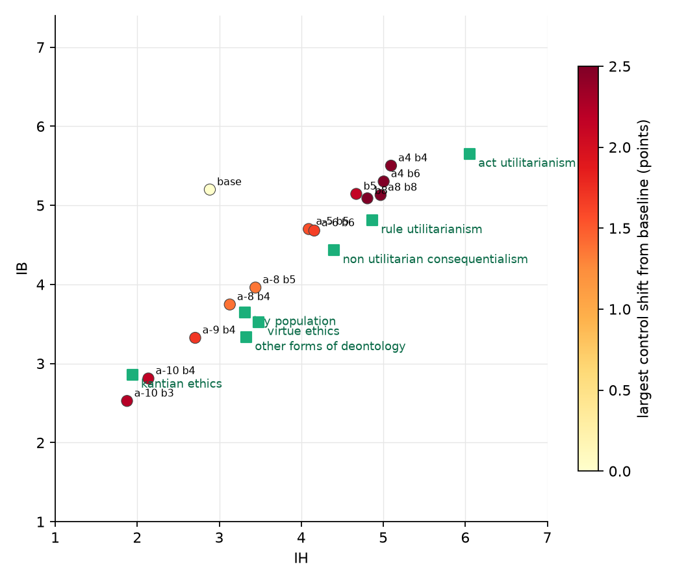

# 8. Final placement, ten iterations, with controls under chain of thought

## What was done

For each human group, the best setting found so far (and one or two neighbours), run
with the paper's full protocol: chain of thought, ten answers per statement and wording,
test statements, judged by the 14B model. For the first time the three control sets were
also answered with chain of thought (three iterations), so the controls are measured the
same way as the scales. Two checks on the method itself: the hook point equals the
extraction point (block output L, verified numerically), and the IB contrast was rebuilt
with more rejecting answers (275 instead of 107): the rebuilt direction has cosine 0.89
with the one in use and is slightly less orthogonal to the IH one (0.31 vs 0.18), so the
original was kept.

## Result

*Final cells in the plane, coloured by the largest shift of any control set from the
unsteered model. Squares: the human groups.*

| group (IB / IH) | setting (a, b) | reached IB / IH | distance | equivalence p | neutral | harm, no benefit | kindness |
|---|---|---|---|---|---|---|---|
| unsteered | | 5.20 / 2.88 | | | 4.22 | 1.58 | 6.30 |
| lay population 3.65 / 3.31 | −8, 4 | 3.75 / 3.13 | 0.21 | **0.002** | −0.5 | +0.8 | −1.4 |
| Kantian 2.86 / 1.94 | −10, 4 | 2.81 / 2.14 | 0.20 | 0.24 | −1.5 | +0.3 | −2.2 |
| non-util. consequentialism 4.43 / 4.40 | −6, 6 | 4.68 / 4.16 | 0.35 | 0.23 | +0.2 | +1.7 | −1.1 |
| rule utilitarianism 4.81 / 4.86 | 0, 8 | 5.09 / 4.81 | 0.28 | 0.38 | +0.7 | +2.7 | −1.0 |
| virtue ethics 3.52 / 3.48 | −8, 4 | 3.75 / 3.13 | 0.42 | 0.35 | −0.5 | +0.8 | −1.4 |
| other deontology 3.33 / 3.33 | −8, 4 | 3.75 / 3.13 | 0.46 | 0.31 | −0.5 | +0.8 | −1.4 |
| act utilitarianism 5.65 / 6.05 | 4, 4 | 5.50 / 5.09 | 0.97 | 0.87 | +1.0 | +2.5 | −0.6 |

Control columns are shifts from the unsteered model, chain of thought.

- **One group is statistically indistinguishable**: the lay population, at (−8, 4), distance
  0.21, equivalence within 0.5 points rejected on both scales (p < 0.001 and 0.002). This is
  the only group whose spread (SD 1.2, N = 300) makes the test decidable; the philosopher
  groups have 11 to 36 members and plotted spreads that, read strictly, imply standard
  deviations near 2, so no condition can pass for them even at 0.2 points away.
- **Every group is within 0.5 points except act utilitarianism** (0.97: IH stops at 5.1).
- **The controls do not hold under chain of thought as well as the fast readout had
  suggested.** Raising IH drags acceptance of pointless harm with it: +0.8 at b = 4, +1.7
  at b = 6, +2.7 at b = 8 (from 1.6 to 4.3 on a 7-point scale). Lowering IB lowers kindness
  (−1.4 at a = −8, −2.2 at a = −10) and, at a = −10, neutral opinions fall to 2.7: the
  Kantian cell is partly "disagree with everything". The cleanest cells are the
  moderate ones: (−8, 4) and (−6, 6), with the largest control shift of 1.4 and 1.7.
- **Steering makes answers more consistent, not less**: within-statement variance falls
  from 1.0 / 1.8 (IB / IH, unsteered) to 0.3 to 1.0 in every steered cell.

## What this settles, and what it does not

With two directions read off the model's own answers, the model can be placed at any
chosen (IB, IH) within about half a point, and at the lay population's position
indistinguishably. What the directions do not separate is instrumental harm from harm as
such: the IH-accepting direction raises both, in proportion. The fast readout hid this
because its single-token answer to "it is acceptable to hurt someone for no reason" stays
at "disagree" long after the reasoned answer has drifted to "neutral". For the bigger
models, the control sets should be answered with chain of thought from the start, and the
IH contrast should be built from answers that accept harm for a reason while rejecting harm
without one, which this run's answer pool now contains.
