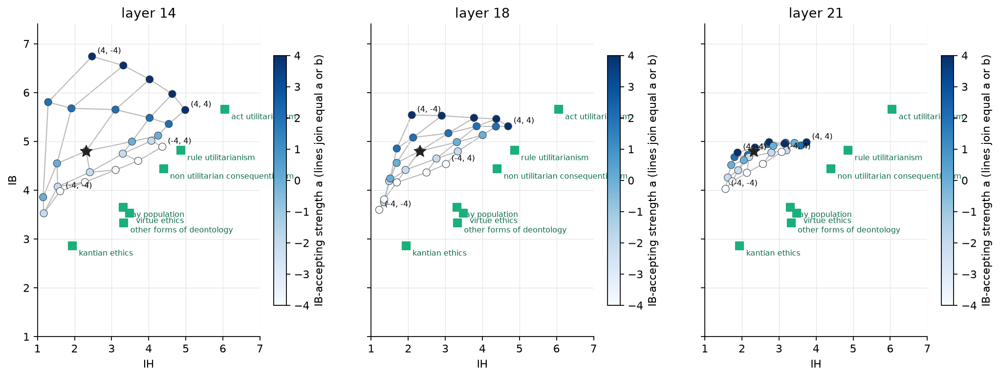
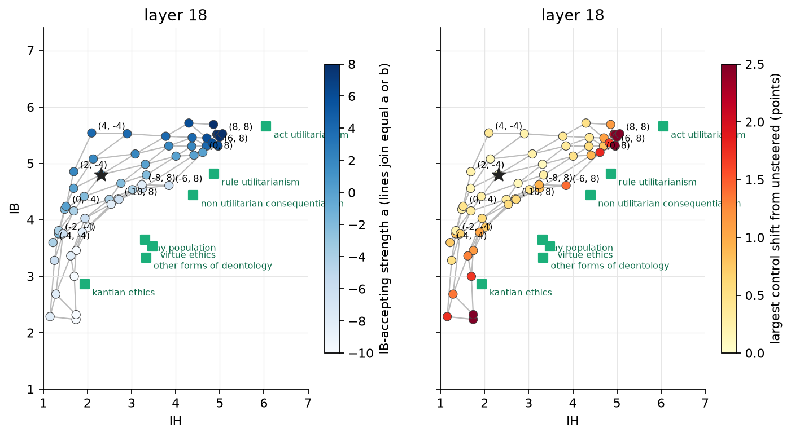

# 10. Does the pipeline transfer to Qwen2.5-7B-Instruct?

## The question

Chapters 6 to 9 were all on the 3B model. The pipeline that came out of them (unprompted
chain-of-thought answers, judge, answer-built accepting-minus-rejecting directions, a grid
of the two directions, inversion of the fitted surface) is stated in `PIPELINE.md`. Does
it work unchanged on the next model of the same family, and where do the two axes sit in
a 28-layer model?

## What was done

The pipeline of `PIPELINE.md`, run once on an H100 with no manual step (`cluster/h100_next_model.sh`):
ten unprompted chain-of-thought iterations on all 99 statements, judge, directions from
the model's own accepting versus rejecting answers, then a 5 x 5 grid of the two
directions (a, b in −4, −2, 0, 2, 4) at three layers (14, 18, 21 of 28, that is 50%, 64%
and 75% of depth; the 3B used layer 23 of 36, 64%), test split, three iterations, with
the three controls under chain of thought, one iteration.

## Result

Unsteered the 7B is less utilitarian than the 3B on both scales: IB 4.80 (3B 5.22), IH 2.31
(3B 2.84). Its controls are cleaner: pointless harm 1.08 (3B 1.55), kindness 6.36.

The 7B accepts 739 of 1,000 rated IB answers and rejects only 125, and accepts 58 of 800 IH
answers: the contrasts are more imbalanced than in the 3B. The two directions are still
nearly orthogonal (cosine 0.10 to 0.18 over the middle layers, 0.12 at layer 18; 3B: 0.18).

*The 5 x 5 grid at each layer in the IH, IB plane. Star: unsteered. Colour: IB strength a.
Green squares: the human groups.*

| layer | cell | IB | IH | neutral | harm, no benefit | kindness |
|---|---|---|---|---|---|---|
| | unsteered | 4.80 | 2.31 | 4.40 | 1.08 | 6.36 |
| 14 | IB +4 | 6.27 | 4.02 | 4.62 | 1.29 | 6.55 |
| 14 | IB −4 | 4.41 | 3.11 | 4.50 | 1.71 | 5.48 |
| 14 | IH +4 | 5.12 | 4.25 | 4.50 | 1.69 | 6.08 |
| 14 | IH −4 | 3.86 | 1.15 | 4.00 | 1.05 | 6.56 |
| 18 | IB +4 | 5.48 | 3.77 | 4.80 | 1.29 | 6.41 |
| 18 | IB −4 | 4.16 | 1.69 | 4.05 | 1.01 | 6.16 |
| 18 | IH +4 | 5.13 | 4.01 | 4.58 | 1.56 | 6.06 |
| 18 | IH −4 | 4.24 | 1.51 | 3.95 | 1.09 | 6.40 |
| 21 | IB +4 | 4.98 | 2.73 | 4.30 | 1.08 | 6.28 |
| 21 | IB −4 | 4.36 | 2.14 | 4.20 | 1.08 | 6.35 |
| 21 | IH +4 | 4.97 | 3.42 | 4.35 | 1.16 | 6.30 |
| 21 | IH −4 | 4.51 | 1.71 | 4.10 | 1.04 | 6.40 |

- **The layer matters more than in the 3B.** Layer 14 moves the most (IB +1.5, IH +1.9 at
  strength 4) but is dirty: lowering IB there raises pointless harm (+0.6) and lowers
  kindness (−0.9), and raising IB raises IH by more than IB. Layer 21 is clean but weak
  (IB at most +0.2, IH +1.1). Layer 18 is the compromise: IH +1.7 for +0.5 of harm, IB
  −0.6 with the controls flat.
- **The IB direction is not as clean as in the 3B.** At layers 14 and 18, raising IB
  raises IH by about as much (layer 18, a = 4: IB +0.7, IH +1.5). Lowering IB lowers IH
  (a = −4: −0.6 and −0.6). Raising IH raises IB by 0.3. The grid is a sheared
  parallelogram rather than a square, and lower-left to upper-right is its long axis.
- **The scales are too small to reach the groups.** The quadratic surface fits well at
  every layer (r 0.96 to 0.99) but no human group is inside the grid; the closest cell to
  the lay population is 0.8 group SD away. As in the 3B, where the lay population needed
  a = −8, the inversion asks for a of −6 to −12.

A second round at layer 18 with a in −10 to −6 and 6 to 8 and b in −2 to 8 (31 cells; a = −12 was tried first and ran every answer to the token cap) is
in `llm.md`; its result is written below when it lands.

## Round 2

Layer 18, a in {−10, −8, −6, 6, 8}, b in {−2, 0, 2, 4, 6, 8} (31 cells, three iterations
on the scales, one on the controls). Together with the round-1 cells at layer 18 this is
the reachable region of the 7B.

*Every layer-18 cell of both rounds. Left: coloured by the IB strength a. Right: coloured by
the largest control shift from unsteered.*

| cell (a, b) | IB | IH | neutral | harm, no benefit | kindness |
|---|---|---|---|---|---|
| unsteered | 4.80 | 2.31 | 4.40 | 1.08 | 6.36 |
| (0, 8) | 5.19 | 4.61 | 4.80 | 2.86 | 6.02 |
| (8, 0) | 5.69 | 4.86 | 4.90 | 2.20 | 6.25 |
| (8, 8) | 5.52 | 5.06 | 5.10 | 5.03 | 6.14 |
| (−6, 0) | 3.75 | 1.45 | 3.72 | 1.16 | 5.78 |
| (−6, 6) | 4.56 | 3.25 | 4.38 | 1.54 | 5.54 |
| (−6, 8) | 4.61 | 3.85 | 4.70 | 2.49 | 5.59 |
| (−8, 0) | 2.68 | 1.28 | 3.18 | 1.06 | 5.00 |
| (−8, 4) | 3.78 | 1.89 | 3.72 | 1.41 | 5.31 |
| (−8, 8) | 4.62 | 3.24 | 4.60 | 2.01 | 5.80 |
| (−10, 0) | 2.32 | 1.74 | 3.05 | 2.01 | 3.80 |
| (−10, 2) | 3.00 | 1.70 | 3.35 | 1.62 | 4.65 |
| (−10, 8) | 4.38 | 2.70 | 4.20 | 1.80 | 5.82 |

- **The region is a curved band, not a plane.** Raising IH saturates near 5.0 (b = 8
  alone 4.61; with a = 8, 5.06) and raising IB near 5.7, so the upper-right corner stops
  short of act utilitarianism (5.65, 6.05). Lowering IB with a alone runs down the left
  edge to (2.3, 1.7); adding b from there moves up and right along a curve, because v_IH
  raises IB (+0.4 at b = 8) and lowering IB lowers IH. The band passes above the cluster of
  the lay population, virtue ethics and other deontology (IB 3.3 to 3.7, IH 3.3 to 3.5):
  low IB with medium IH is not reached. Closest cells: lay population (−6, 6) at 0.91
  group SD; virtue (−6, 6) 1.06; deontology (−6, 4) 1.20.
- **The controls break below a = −6.** At a = −8 neutral opinions fall by 1.2 and
  kindness by 1.4; at a = −10 by 1.4 and 2.6, pointless harm rises by 0.9, and the
  within-statement s.d. doubles (IB 2.0, IH 1.7). A few answers at a = −10 run to the
  token cap (4 of 648 at (−10, −2)) or give no rating (3 to 4 per cell). The Kantian group
  is the one group within 0.5 (cell (−10, 2), d 0.27), and it is reached in this broken
  regime.
- **The harm control follows IH, as in the 3B.** Per point of IH gained: pointless harm
  +0.8 at (0, 8), +1.4 at (8, 8). Raising IB alone at 6 is clean (harm +0.4, neutral
  +0.5) but carries IH along (+2.0).
- **The quadratic fit is worse on IH** (r 0.96, rmse 0.36 against 0.99 / 0.13 for IB)
  because of the saturation; the inversion puts every low group at the a = −10 bound.

## Reading

The pipeline transfers: the two directions exist in the 7B, are near-orthogonal, and each
moves its scale by 2 to 2.5 points with the other scale moving less. What does not
transfer is the reach. The 3B's grid was a near-rectangle that covered six of seven groups;
the 7B's is a sheared band whose lower edge (IB 3.5 to 4.6 at IH 3 to 4) stays 0.5 to 1.0
points above the human cluster, and the edge that would reach it (a < −6) is where the
model stops answering the controls normally. In the 7B the IB direction is also the
direction that lowers agreement and kindness once pushed far, so a low-IB, medium-IH
persona is not a point of this model's plane at this layer. A different layer for the
negative IB side, or an IB direction built from a balanced contrast (the 7B rejected only
125 of 1,000 train answers), are the two things to try; a 14B is the other.
