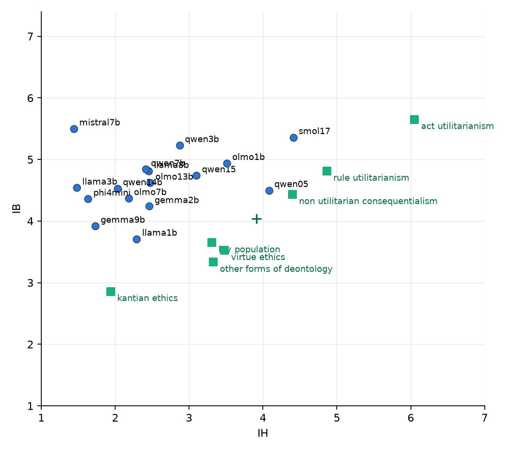

# 11. Where do models of different sizes sit unsteered?

## The question

Chapter 10 ended with a simple reading of the 7B's failure: the 3B started near the middle
of the human cluster and small strengths moved it; the 7B starts far from it, near the
low-IH edge, and the strengths needed to cross the gap break the model or the controls. If
that is right, a model that starts closer to the lay population should be steerable to it
with the unchanged pipeline. The first step is to know where many models start.

## What was done

Fifteen open instruction-tuned models from 0.5B to 14B parameters, six families, placed
with the reduced protocol: the 54 test statements, the four kept wordings, five
chain-of-thought answers each (1,080 scale answers per model), the three control sets
once (200), the 14B judge. Each model answers through its own chat template with no system
prompt; the Qwen models keep their default one, so the 3B and 7B rows are the base runs of
chapters 8 and 10. Mistral-7B-Instruct-v0.3 failed on a corrupted tokenizer download and
was rerun after the chapter-12 queue.

## Result

*Unsteered position of each model in the IH, IB plane. Squares: human groups; cross: their
centre.*

| model | IB | IH | neutral | harm, no benefit | kindness | distance to lay | nearest group |
|---|---|---|---|---|---|---|---|
| Llama-3.2-1B | 3.71 | 2.29 | 3.52 | 1.58 | 5.28 | 1.02 | Kantian (0.92) |
| Gemma-2-2B | 4.24 | 2.46 | 3.80 | 2.35 | 6.01 | 1.03 | lay (1.03) |
| Qwen2.5-1.5B | 4.74 | 3.10 | 4.33 | 2.14 | 5.99 | 1.11 | lay (1.11) |
| Qwen2.5-0.5B | 4.50 | 4.08 | 4.67 | 3.50 | 4.93 | 1.15 | non-util. conseq. (0.33) |
| OLMo-2-13B | 4.62 | 2.47 | 4.45 | 1.00 | 6.60 | 1.29 | lay (1.29) |
| OLMo-2-1B | 4.94 | 3.51 | 5.72 | 1.90 | 5.65 | 1.30 | non-util. conseq. (1.02) |
| OLMo-2-7B | 4.37 | 2.18 | 4.55 | 1.06 | 6.19 | 1.34 | lay (1.34) |
| Llama-3.1-8B | 4.81 | 2.45 | 4.53 | 1.08 | 6.49 | 1.45 | lay (1.45) |
| Qwen2.5-7B | 4.84 | 2.41 | 4.35 | 1.06 | 6.35 | 1.49 | lay (1.49) |
| Qwen2.5-14B | 4.53 | 2.03 | 4.47 | 1.00 | 6.71 | 1.55 | lay (1.55) |
| Gemma-2-9B | 3.92 | 1.73 | 4.40 | 1.00 | 6.49 | 1.60 | Kantian (1.08) |
| Qwen2.5-3B | 5.23 | 2.87 | 4.53 | 1.55 | 6.31 | 1.64 | lay (1.64) |
| Phi-4-mini | 4.36 | 1.63 | 4.53 | 1.20 | 6.79 | 1.82 | Kantian (1.53) |
| SmolLM2-1.7B | 5.36 | 4.41 | 5.68 | 3.12 | 5.76 | 2.03 | rule util. (0.71) |
| Llama-3.2-3B | 4.54 | 1.48 | 3.95 | 1.65 | 6.14 | 2.04 | Kantian (1.74) |
| Mistral-7B-v0.3 | 5.50 | 1.44 | 4.30 | 1.00 | 7.00 | 2.63 | lay (2.63) |

- **Every model sits above and to the left of the human cluster.** IB runs from 3.7 to
  5.5 and IH from 1.4 to 4.4; no model is below IB 3.7, where the lay population, virtue
  ethics and deontology sit. The nearest is one point away; Mistral-7B is the farthest,
  with the highest IB, the lowest IH and kindness at the ceiling.
- **Size pushes IH down.** All models of 7B and more sit at IH 1.4 to 2.5 with the
  pointless-harm control at 1.0 to 1.1: they reject harm firmly in both cases. The models
  with higher IH are small (Qwen 0.5B 4.1, SmolLM2 4.4, OLMo 1B 3.5, Qwen 1.5B 3.1), and
  their pointless-harm control rises with it (3.5, 3.1, 1.9, 2.1). Closeness to the human
  cluster in these models is partly a weaker rejection of harm of any kind, the same
  coupling chapters 8 and 9 found inside one model when IH is steered up.
- **IB is nearly flat across sizes** (4.4 to 4.9 for most), with the 3B and SmolLM2 high
  and Llama 1B and Gemma 9B low.
- **Qwen 1.5B and 0.5B leave 15% and 5% of answers unrated**: the judge finds no level
  in them, usually because the answer does not finish. The 3B and 7B and all models of 7B
  and more leave none.

## What runs next

The unchanged first-round pipeline (ten unprompted iterations, directions, 5 x 5 grid at
three depths, controls) on the four models nearest the lay population: Llama-3.2-1B,
Gemma-2-2B, Qwen2.5-0.5B, Qwen2.5-1.5B. The hypothesis predicts that a strength that left
the 7B short reaches the lay population in these, with the controls intact. Chapter 12.
