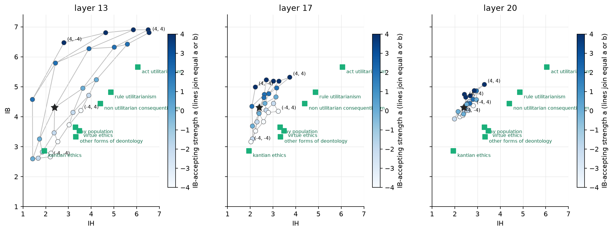
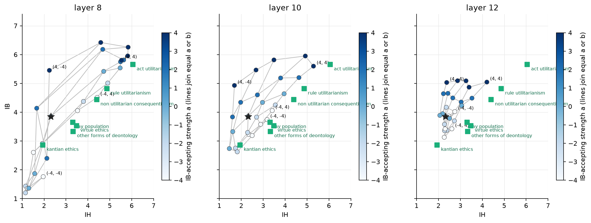
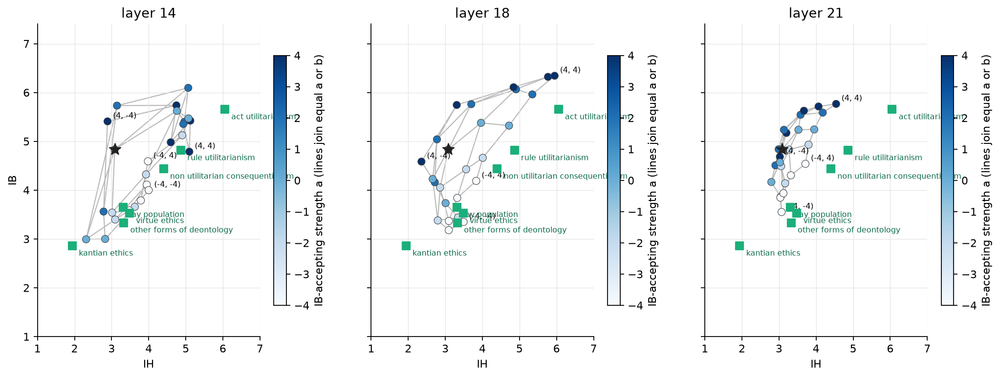
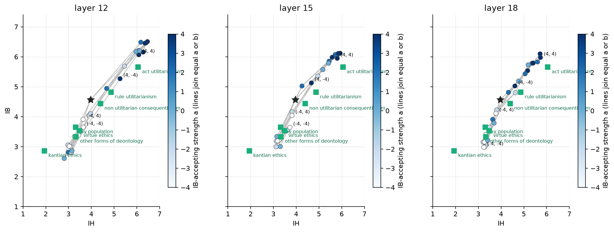

# 12. Does a model that starts nearer the lay population reach it?

## The question

Chapter 10 left the 7B unable to reach the low-IB, medium-IH cluster where the lay
population, virtue ethics and deontology sit: the strengths that would get there broke the
controls. The reading proposed was that the 7B starts far from that cluster and the 3B
started near it. Chapter 11 placed fourteen models unsteered and found four within about
one point of the lay population: Llama-3.2-1B, Gemma-2-2B, Qwen2.5-0.5B and Qwen2.5-1.5B.
If the reading is right, the unchanged first-round pipeline, with strengths no larger than
4, should bring these four to the lay population with the controls intact.

## What was done

`cluster/h100_queue.sh` ran the chapter-10 chain on each of the four, one after the other,
with no manual step: ten unprompted chain-of-thought iterations on all 99 statements, the
14B judge, directions from the model's own accepting versus rejecting answers, then the
5 x 5 grid (a, b in −4, −2, 0, 2, 4) at three blocks placed at 50%, 64% and 75% of depth
(Llama 1B: 8, 10, 12 of 16; Gemma 2B: 13, 17, 20 of 26; Qwen 0.5B: 12, 15, 18 of 24;
Qwen 1.5B: 14, 18, 21 of 28), test split, three iterations, controls once. The same
equivalence test as chapter 8 (margin 0.5 on each scale, both one-sided Welch tests at
0.05), the same quadratic surface fit and inversion.

## Result

| model | IB high / low | IH high / low | cos(v_IB, v_IH) at the kept block | unrated grid answers |
|---|---|---|---|---|
| Llama-3.2-1B | 420 / 523 | 86 / 672 | 0.38 (block 10) | 0.3% |
| Gemma-2-2B | 380 / 382 | 25 / 697 | 0.22 (block 13) | 0.0% |
| Qwen2.5-0.5B | 492 / 179 | 286 / 182 | 0.71 (block 12) | 9% |
| Qwen2.5-1.5B | 497 / 123 | 86 / 330 | 0.17 (block 18) | 17% |

*Counts of accepting and rejecting train answers that built each direction; the 7B had
739 / 125 and 58 / 721 with cosine 0.12.*

*Gemma-2-2B: the 5 x 5 grid at each block in the IH, IB plane. Star: unsteered. Colour: IB
strength a. Green squares: the human groups.*

*Llama-3.2-1B, same layout.*

*Qwen2.5-1.5B, same layout.*

*Qwen2.5-0.5B, same layout.*

Single-axis cells at the kept block (strength ±4) and the cell that passes the
equivalence test for the lay population, with its distance in group standard deviations:

| model, block | cell (a, b) | IB | IH | neutral | harm, no benefit | kindness | reached |
|---|---|---|---|---|---|---|---|
| Gemma 2B, 13 | unsteered | 4.31 | 2.39 | 3.80 | 2.36 | 6.01 | |
| | (4, 0) | 6.90 | 5.86 | 6.15 | 1.46 | 6.48 | |
| | (−4, 0) | 3.17 | 2.53 | 3.15 | 2.64 | 4.24 | |
| | (0, 4) | 5.23 | 4.23 | 4.70 | 2.16 | 5.78 | |
| | (0, −4) | 2.59 | 1.43 | 3.22 | 2.28 | 5.84 | |
| | (−4, 2) | 3.73 | 3.03 | 3.45 | 2.44 | 4.90 | lay population (0.29) |
| | (−2, −2) | 2.82 | 1.85 | 2.90 | 2.34 | 3.98 | Kantian (0.09, p 0.24) |
| Llama 1B, 10 | unsteered | 3.85 | 2.31 | 3.35 | 1.76 | 4.91 | |
| | (4, 0) | 5.81 | 3.49 | 5.82 | 2.54 | 6.22 | |
| | (−4, 0) | 3.19 | 2.50 | 3.45 | 1.76 | 4.60 | |
| | (0, 4) | 4.64 | 3.95 | 4.82 | 2.91 | 5.14 | |
| | (0, −4) | 2.74 | 1.45 | 3.10 | 1.34 | 4.71 | |
| | (−4, −4) | 3.74 | 3.18 | 4.12 | 2.00 | 4.54 | lay population (0.15) |
| Qwen 1.5B, 18 | unsteered | 4.83 | 3.08 | 4.66 | 2.15 | 5.75 | |
| | (4, 0) | 6.11 | 4.84 | 5.88 | 2.91 | 6.39 | |
| | (−4, 0) | 3.37 | 3.10 | 3.67 | 2.62 | 4.43 | |
| | (0, 4) | 5.32 | 4.72 | 4.80 | 3.56 | 5.70 | |
| | (0, −4) | 3.73 | 3.01 | 3.81 | 3.07 | 4.29 | |
| | (−4, 2) | 3.84 | 3.32 | 4.00 | 2.69 | 4.63 | lay population (0.19) |
| | (−2, −4) | 3.44 | 3.34 | 3.91 | 2.79 | 3.67 | deontology (0.08), lay (0.24) |
| Qwen 0.5B, 12 | unsteered | 4.56 | 3.97 | 4.68 | 3.53 | 4.95 | |
| | (4, 0) | 6.45 | 6.36 | 6.38 | 5.51 | 6.40 | |
| | (−4, 0) | 3.01 | 3.04 | 3.50 | 2.38 | 2.74 | |
| | (0, 4) | 6.20 | 6.11 | 5.95 | 5.18 | 5.94 | |
| | (0, −4) | 2.87 | 3.15 | 3.10 | 2.18 | 2.74 | |
| | (−2, −4) | 3.34 | 3.26 | 3.19 | 2.55 | 2.66 | deontology (0.03) |
| | (−4, −2) | 3.39 | 3.45 | 3.42 | 2.89 | 3.06 | lay population (0.30) |

Quadratic surface at the kept block, 25 cells: Gemma IB r 0.97, IH r 0.98; Llama IB
0.95, IH 0.98; Qwen 1.5B IB 0.98, IH 0.96; Qwen 0.5B IB 0.84, IH 0.87. The inversion puts
the lay population at (−4.0, +1.6) for Gemma, (−2.8, +3.5) for Llama, (−4.0, +0.2) for
Qwen 1.5B, each with residual under 0.35, and act utilitarianism at the b = 4 bound in all
three.

- **All four models pass the equivalence test for the lay population inside the first
  grid.** No cell of the 7B's two rounds did. The closest cells are 0.15 to 0.30 group
  standard deviations away, against 0.9 for the 7B. Gemma also reaches the Kantian group
  at (−2, −2) in distance (0.09) but not in the test (p 0.24, because its answers there
  vary more). Qwen 1.5B and 0.5B reach other deontology as well.
- **Gemma-2-2B is the clean case.** Its block-13 grid is a monotone fan that covers the
  whole human cluster (IB 2.6 to 6.9, IH 1.4 to 6.6), each direction moves its own scale
  with the right sign in both directions (v_IB: −1.1 / +2.6; v_IH: −1.0 / +1.8), and the
  pointless-harm control stays between 1.4 and 2.9 over all 25 cells (unsteered 2.36). The
  cost is kindness: lowering IB by 1.1 lowers kindness by 1.8, and the lay cell loses 1.1
  of kindness and 0.35 of neutral agreement. Its IH direction came from only 25 accepting
  answers, and still moves IH.
- **Llama-3.2-1B reaches the lay population at a cell its own axes do not predict.** At
  block 10 the single-axis cells behave (v_IB −0.7 / +2.0 on IB, v_IH −0.9 / +1.6 on IH),
  but the lay cell is (−4, −4): both strengths negative, yet IH rises by 0.9 where (−4, −2)
  and (−4, 0) leave it at 2.3 to 2.5. The surface fit puts the lay population at (−2.8,
  +3.5) instead. Neutral agreement rises by 0.8 at that cell. Block 8 moves everything
  together (IB −2.5 at (0, −4), kindness −3.5) and block 12 moves little.
- **Qwen2.5-1.5B reaches it with the IB direction alone**, (−4, 0) and (−4, 2) at block 18
  and (−4, 0) at block 14, but 17% of its grid answers do not finish and the judge finds no
  level in them (15% unsteered in chapter 11). Kindness falls by 1.1 to 1.3 and pointless
  harm rises by 0.5 at those cells. Raising IH raises the harm control as in every model so
  far (+1.4 at (0, 4)).
- **Qwen2.5-0.5B does not have two directions.** Its v_IB and v_IH have cosine 0.71 and
  every cell moves all five sets by the same amount in the same direction: (4, 0) and
  (0, 4) both put IB, IH, neutral, harm and kindness at 6; (−4, 0) and (0, −4) put all of
  them at 2.2 to 3.5. Its passes of the equivalence test are a global shift of every score
  toward 3, which is where the lay population and deontology happen to sit, and kindness
  falls to 2.7 there. The surface fit is the worst (r 0.84).
- **The confound of chapter 11 holds inside the grid.** Each of the three usable models
  reaches the lay cell with kindness 1.1 lower than unsteered (Gemma 4.90, Llama 4.54, Qwen
  1.5B 4.63 against 6.01, 4.91, 5.75), and a neutral control that moves by 0.35 to 0.8. The
  3B reached the lay population with kindness −0.3 and neutral −0.2 (chapter 8).

## Reading

The hypothesis of chapter 10 holds in its first half: a model that starts one point from
the lay population reaches it with strengths of 4 or less, where the 7B needed 6 to 10 and
broke. Three of the four small models do, and Gemma-2-2B does it with a grid as regular as
the 3B's and with the harm control flat. It fails in its second half: the controls are
not intact. The price of moving a small model down the IB scale is a kindness score one
point lower, and in Llama and the two Qwens a neutral score that moves too. The lay
population is reached, but by a model that is also less kind on statements with no
utilitarian content. Chapter 8's 3B paid 0.3 for the same move; whether the difference is
size, family or the block chosen is open. Qwen2.5-0.5B shows what the test does not
guard against: a model whose every score moves together passes it whenever the global
shift lands on a group. The within-statement standard deviation and the three controls
are what separate that from steering, and they should be reported with every match.

Next: a second round at Gemma's block 13 with strengths between the grid points and a
kindness-matched readout (does any cell reach the lay population with kindness within 0.5
of unsteered), and the chapter-10 options (`OPTIONS.md`) on the 7B now that a model with a
regular plane exists to compare against.
