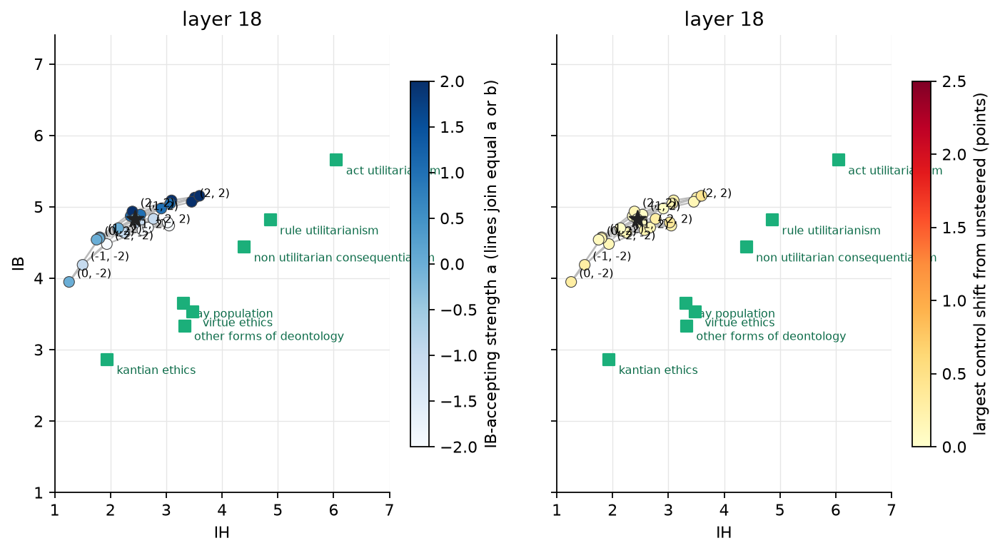

# 13. Does matching the token distribution instead of adding a vector widen the 7B's reach?

## The question

The additive hook adds s times a fixed vector to every token state and keeps pushing past
anything the model ever produced; the 7B broke under it at a = −8 (chapter 10). The persona
work in manifold-persona replaced it with an affine hook: at strength 1 every token state
is moved so that its mean and its per-dimension spread match those of the target answers,
and the strength scales that whole move. The move is bounded by a distribution the model
did produce. Does it reach the human cluster in the 7B where the additive hook did not?

## What was done

Token statistics at block 18 from the 7B's judged unprompted train answers
(`scripts/aff_stats.py`): mean and per-dimension standard deviation over the response
tokens of the IB-accepting answers (739 answers, 131,000 tokens), IB-rejecting (125,
21,000), IH-accepting (58, 12,000), IH-rejecting (721, 142,000), and the pooled mean and
spread over all rated answers of both axes (333,000 tokens). The hook (`moral_axes/cells.py`,
mode `aff`): h + |s| (mu_t − mu_p + (sd_t / sd_p − 1)(h − mu_p)), t the accepting set for
s > 0 and the rejecting set for s < 0, ratio clipped at 3. A 5 x 5 grid, a and b in −2,
−1, 0, 1, 2, test split, three repetitions, controls once, 14B judge; generation on
margaret over two H100 and four RTX 6000 cards (cells split by job), judge over three H100.

## Result

*The 25 affine cells at block 18. Left: colour is a. Right: colour is the largest control
shift from unsteered.*

| cell (a, b) | IB | IH | neutral | harm, no benefit | kindness |
|---|---|---|---|---|---|
| unsteered | 4.83 | 2.44 | 4.40 | 1.05 | 6.40 |
| (2, 0) | 5.15 | 3.59 | 4.55 | 1.48 | 6.31 |
| (−2, 0) | 4.78 | 3.02 | 4.32 | 1.44 | 6.25 |
| (0, 2) | 4.54 | 1.75 | 4.30 | 1.00 | 6.41 |
| (0, −2) | 3.95 | 1.26 | 4.10 | 1.04 | 6.48 |
| (2, 2) | 5.07 | 3.45 | 4.55 | 1.11 | 6.30 |
| (−2, −2) | 4.48 | 1.93 | 4.25 | 1.06 | 6.35 |

Quadratic fit: IB r 0.93, IH r 0.97. No cell passes the equivalence test for any group;
the closest cell to the lay population is 1.12 group standard deviations away (additive
block-18 grid: 0.91). Every answer finished and was rated.

- **The grid covers a fifth of the additive grid.** IB spans 3.95 to 5.15 and IH 1.26 to
  3.59, against 2.3 to 5.7 and 1.2 to 5.1 for the additive grid at the same block.
- **The moves have the wrong signs.** Toward the IB-accepting distribution (a = 2) IB
  rises 0.3 and IH rises 1.2; toward the IB-rejecting one (a = −2) IB does not move and IH
  rises 0.6. Toward the IH-accepting distribution (b = 2) IH falls 0.7; toward the
  IH-rejecting one (b = −2) it falls 1.2. Neither axis moves its own scale with its sign.
- **The cause is the pooled centre.** The centre was the mean over both axes' answers. The
  two axes answer different statements, and the content difference between IB and IH
  answers (12.5 in token-mean norm) is twice the stance contrast within an axis (5.8 for IB,
  4.1 for IH). The IB-accepting shift, mu_IBacc − mu_p, has cosine −0.05 with the IB
  contrast mu_IBacc − mu_IBrej and the two accepting shifts have cosine −0.84 with each
  other: the grid steered along "which kind of statement is this" and only incidentally
  along the stance.
- **The spread term is empty.** The per-dimension spread of accepting and rejecting answers
  is the same: median ratio 0.99, largest 1.31, so the gain term moves a state by 0.3 to
  0.8 against 6 to 8 for the mean shift. Matching mean and spread is matching the mean.
- **The token-level contrast is the additive direction.** mu_acc − mu_rej over tokens has
  cosine 1.00 with the answer-level direction of chapter 10 on both axes.

## Reading

Done with a per-axis centre, the affine hook is the additive hook with a different unit:
the shift toward the accepting set is (n_rej / n) times the acc-minus-rej contrast, and the
shift toward the rejecting set is (n_acc / n) times it, with no spread term because there
is no spread difference. For the 7B that is 0.14 of the additive IB vector per unit
strength on the accepting side and 0.86 on the rejecting side, both inside the additive
grid already run at ±2 and ±4. The rerun would reproduce chapter 10's cells. The thing
the persona setting had, personas answering the same questions with different token
distributions, this setting does not: the model's accepting and rejecting answers to a
statement differ in mean and not in spread. The hook change from manifold-persona does
not transfer, and the limit on the 7B's reach is the direction, not the hook.
