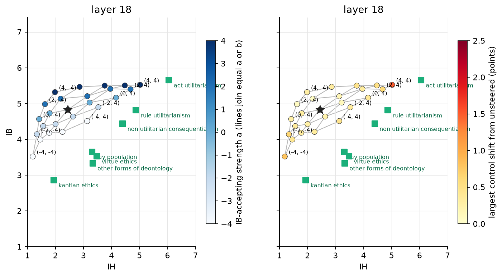

# 14. Does an IH direction induced by the prompt widen the 7B's reach?

## The question

The 7B's IH direction (chapter 10) was the mean of 58 accepting answers minus the mean of
721 rejecting ones: the model, unprompted, almost never accepts an instrumental-harm
statement. A contrast built from so few examples might point along whatever those 58
happened to share rather than along acceptance itself, and that could be why IH saturates
near 5 and the band misses the human cluster. The direction can instead be induced: make
the model accept under the IH system prompt, then read those answers in the frame the
steering acts in, with no axis prompt in context. If the thin contrast was the limit, the
induced direction should reach further.

## What was done

The 7B answered the 20 IH train statements under the IH system prompt, ten repetitions,
four wordings (800 answers), with chain of thought, and the 14B judge rated them. The
directions script then re-encoded every answer, prompted and unprompted, with no axis
prompt, and took the IH direction as the mean of all accepting answers (prompted and
unprompted) minus the mean of all rejecting ones. The IB direction was rebuilt from the
same unprompted answers as before. The same 5 x 5 additive grid as chapter 10 at block 18,
a and b in −4, −2, 0, 2, 4, test split, three repetitions, controls once, 14B judge.

## Result

The prompt induces acceptance. Of the 800 prompted answers the judge rated 395 as
accepting, against 58 of 800 unprompted. The IH contrast is now 453 accepting against
1,093 rejecting. The new IH direction at block 18 has cosine 0.69 with the old one and is
14% longer (norm 5.01 against 4.41); its cosine with the IB direction is 0.22 (old 0.12).

*The 25 cells of the induced-contrast grid at block 18. Left: colour is a. Right: colour
is the largest control shift from unsteered.*

| cell (a, b) | IB | IH | neutral | harm, no benefit | kindness | chapter 10 IB / IH |
|---|---|---|---|---|---|---|
| unsteered | 4.83 | 2.44 | 4.40 | 1.05 | 6.40 | 4.80 / 2.31 |
| (0, 4) | 5.16 | 4.16 | 4.72 | 1.42 | 6.24 | 5.13 / 4.01 |
| (0, −4) | 4.57 | 1.42 | 4.12 | 1.02 | 6.54 | 4.24 / 1.51 |
| (4, 4) | 5.52 | 5.02 | 4.95 | 2.55 | 6.22 | 5.31 / 4.69 |
| (−4, 4) | 4.51 | 3.13 | 4.35 | 1.31 | 5.95 | 4.53 / 3.02 |
| (−4, −4) | 3.52 | 1.19 | 3.60 | 1.01 | 6.34 | 3.60 / 1.22 |

Quadratic fit: IB r 0.99, IH r 0.99. No cell passes the equivalence test for any group.
Closest cell to the lay population: 0.88 group standard deviations (chapter 10 grid at the
same block and strengths: 0.91). Every answer finished and was rated.

- **The grid is the chapter 10 grid.** Over the 24 steered cells the mean difference
  between the two grids is 0.07 (IB), 0.05 (IH), 0.03 (neutral), 0.00 (harm) and 0.03
  (kindness); the largest is 0.39 on IB and 0.33 on IH, against a run-to-run difference of
  0.13 on IH at the unsteered cell itself. IH spans 1.19 to 5.02 (chapter 10: 1.22 to
  4.69); IB spans 3.52 to 5.52 (3.60 to 5.54).
- **The small gain on IH is the longer vector.** Strength is in units of the direction's
  norm, so b = 4 with the new direction is a push 14% larger; the cells with b = 4 gain
  0.15 to 0.33 on IH, and (4, 4) pays for it with the harm control at 2.55 (chapter 10:
  1.88).
- **The surface inversion lands in the same place.** The lay population is predicted at
  a = −10.9, b = 8.7, virtue ethics and other deontology at the a = −12 bound: the
  strengths that broke the controls in chapter 10.

## Reading

Eight times the accepting answers, and a direction that shares only 0.69 of its cosine
with the old one, give the same reachable band to within noise. The 58-answer contrast was
not the limit: the part of the new direction that differs from the old one does nothing
to the scores at these strengths, and the part that moves IH is the part the two share.
The 7B's limit is where the band lies and where the controls break, not how the IH
direction was estimated. Option 1 of OPTIONS.md (more accepting answers) is answered.
