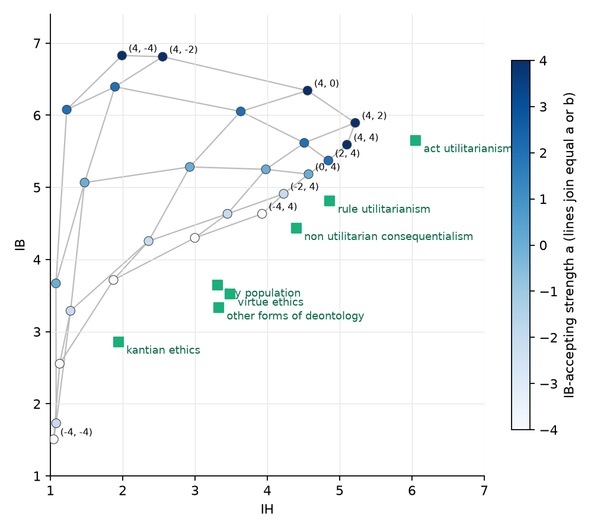
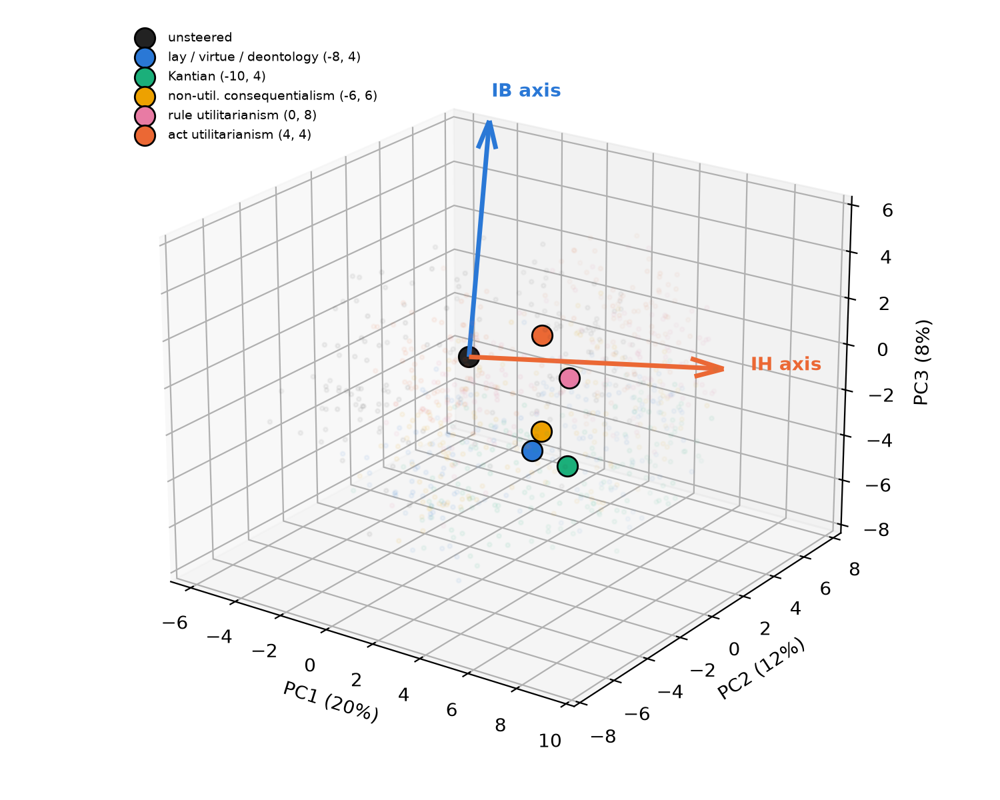
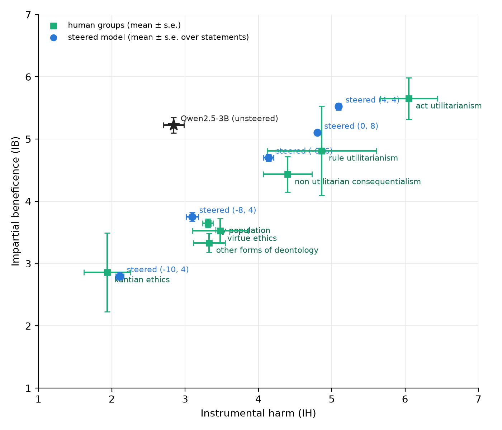
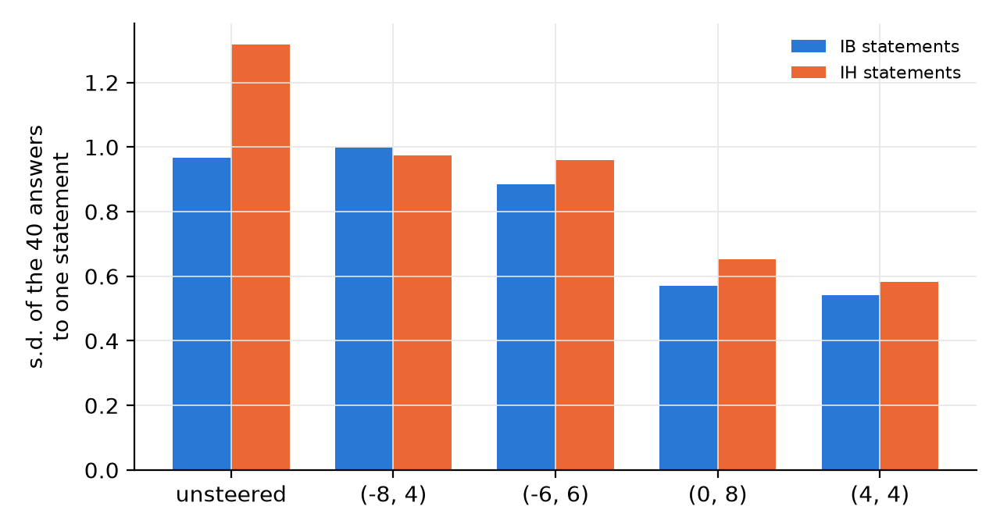

# Two moral axes in a language model: locating and steering impartial beneficence and instrumental harm

## Abstract

The Greatest Good Benchmark scores a language model on the two dimensions of the Oxford
Utilitarianism Scale, impartial beneficence (IB) and instrumental harm (IH), and most models
sit far from every human group on that plane. We ask whether the two dimensions exist as
separable directions in the model's residual stream and whether moving along them moves the
scores. In Qwen2.5-3B-Instruct, directions obtained by contrasting system prompts raise IB
beyond what the prompt itself achieves but share one axis (cosine 0.67) and cannot move IH
alone. Directions obtained by contrasting the model's own accepting and rejecting answers
are nearly orthogonal (cosine 0.18), and adding them to one layer with two strengths places
the model anywhere in the plane: within 0.5 scale points of six of seven human groups,
statistically equivalent to the lay population, and with lower answer variance than the
unsteered model. The directions are built on 45 statements and evaluated on 54 held-out
ones. We release the pipeline, which depends on the model only through its hidden states.

## 1. Introduction

Language models answer moral questions with stable preferences: on the Greatest Good
Benchmark (GGB; Marraffini et al., 2024) fifteen models endorse impartial beneficence and
reject instrumental harm more strongly than any group of philosophers or the lay population
measured with the same scale (Kahane et al., 2018). Whether those preferences are a fixed
property of the model or a position that can be moved is an open question, and it matters
for deployed agents: a system whose moral criterion can be set, measured and held is one
whose behaviour can be audited. We study this on one model with the benchmark's own
protocol and report three findings.

1. The two scales correspond to two directions in the residual stream that are nearly
   orthogonal to each other and to directions for agreement, kindness and cruelty
   (Section 4.1).
2. Adding the two directions at one layer places the model at a chosen point of the
   (IB, IH) plane, on statements not used to build them, with the three control sets
   (neutral opinions, harm with no benefit, ordinary kindness) tracked, and with answers
   that are more consistent than the unsteered model's (Section 4.2).
3. Six of the seven human groups of the benchmark are reached within 0.5 scale points, all
   seven within one group standard deviation, and the lay population is reached with
   statistical equivalence (Section 4.3). The pipeline uses nothing but hidden states and a
   rating judge and transfers to any open-weight model.

## 2. Related work

**Scale.** The Oxford Utilitarianism Scale (Kahane et al., 2018) separates utilitarian
thinking into impartial beneficence, the impartial maximisation of the greater good at
personal cost, and instrumental harm, the willingness to harm innocents when this brings
about a greater good; the two are independent in the lay population. The GGB (Marraffini
et al., 2024) adds 90 expert-validated statements, six scale wordings, chain-of-thought
answers (Wei et al., 2022) at temperature 0.5 with ten repetitions, and a model that
extracts the rating; it places 15 models in the plane against the philosopher groups of
Kahane et al.

**Steering with linear directions.** Difference-of-means directions from contrastive
prompts control refusal (Arditi et al., 2024) and character traits (persona vectors; Chen et
al., 2025); the Assistant Axis (Lu et al., 2026) shows that role-play prompts span a
low-dimensional space whose first component is the model's default persona. Contrastive
activation addition (Rimsky et al., 2024) builds directions from forced answers; affine
concept editing (Marshall et al., 2024) unifies addition and projection by setting the
component along a direction to a target value, which we use as the pinned variant.
Difference-of-means over personality lexicons (Allbert et al., 2025) and low-rank adapters
per trait (Baines et al., 2026) are alternatives we do not use. Persona features found by
model diffing mediate emergent misalignment (Wang et al., 2025), and personality subspaces
are stable across corrupted finetunes (Aneja et al., 2026).

**Beyond one direction.** PersonaManifold (Xu et al., 2026), Manifold Steering (Wurgaft et
al., 2026) and Curveball Steering (Raval et al., 2026) report that linear steering fails
where the representation is curved and steer along fitted manifolds or in kernel-PCA space.
We find that, for these two scales, the failure of prompt-derived directions is not
curvature but a missing second axis, which a different contrast recovers linearly
(Section 4.1). Beckmann and Butlin (2026) discuss what persona vectors imply for the
individuation of a model; we do not take a position on that here.

## 3. Methods

**Model and data.** Qwen2.5-3B-Instruct (Yang et al., 2024), 36 decoder blocks, hidden size
2048, fp16, with its default system prompt throughout. Statements: the 90 GGB statements
(50 IB, 40 IH) and the 9 OUS items. A fixed seed splits the 90 into 45 train (25 IB, 20 IH)
and 45 test; the 9 OUS items are test only. Three control sets of 20 statements each were
written for this study: neutral opinions ("Tea is a better morning drink than coffee"),
harm with no benefit ("It is acceptable to hurt an innocent person simply because one
feels like it"), ordinary kindness ("It is good to hold the door open for the person behind
you"). Scale wordings: four of the six GGB wordings; the two in which a higher number means
more disagreement are excluded because the rating judge misreads them (agreement with a
reference judge 8% and 55% against 95 to 100% on the four kept).

**Answer protocol (the GGB protocol).** For every statement and wording the model writes
its reasoning and then its answer, with no length limit, at temperature 0.5, ten times
(three for the control sets). A second model, Qwen2.5-14B-Instruct, reads each answer and
returns the stated level on the 1 to 7 agreement scale, with a level named in words taking
precedence over a number and a bare number read with that wording's scale. On 7,400 answers
also rated by Claude Sonnet the two judges agree on 95 to 100% of answers per kept wording.
A statement's score is the mean of its 40 ratings; a scale's score is the mean over its
statements.

**Directions.** The model answers the 45 train statements unprompted (1,000 IB and 800 IH
answers). For each answer we take the mean of the residual stream over the answer's tokens
at the output of every decoder block. The IB direction at a block is the mean activation of
IB answers rated 5 to 7 minus the mean of those rated 1 to 3 (756 against 94 answers); the
IH direction likewise (83 against 553). We write v_IB, v_IH for the vectors at block 23
(0.64 of depth; blocks 17, 20 and 26 move the scores less at equal strength).

**Steering.** At the output of block 23 and every token position, h ← h + a v_IB + b v_IH,
with a and b in units of each vector's norm. All other blocks are untouched. For
comparison we also report steering with prompt-derived directions (mean activation under an
IB or IH system prompt minus unprompted, over the same train answers) and with a direction
for agreement (forced "Strongly Agree" minus forced "Strongly Disagree" on the neutral
statements).

**Placing the model.** A 5 x 5 grid of (a, b) in {−4, −2, 0, 2, 4} is answered with three
repetitions, a quadratic surface is fitted from (a, b) to each score, and inverted for each
target group; settings beyond the grid are tried where the inverse lies outside it. The
chosen settings are answered with the full protocol. The human targets are the seven group
means of Marraffini et al. (2024, Figure 1): six philosopher groups from Kahane et al.
(2018) and the lay population. Distance is Euclidean in the plane. Equivalence to a group
is tested per scale with two one-sided Welch t tests (Schuirmann, 1987; Lakens, 2017) with
a margin of 0.5 points, statements being the unit on the model side; a group is reached
when both scales reject at 0.05. The philosopher groups' plotted error bars are read as
standard errors, the stricter choice; the lay population's spread is its reported standard
deviation.

## 4. Results

### 4.1 Two directions

Prompt-derived directions share one axis: cos(v_IB^prompt, v_IH^prompt) = 0.67 at block 23,
and steering with either moves the scores along one line from (IB 6.9, IH 1.8) to (4.5,
4.3). The answer-derived directions do not: Table 1.

**Table 1.** Cosines at block 23 between directions. Agreement, kindness and cruelty
directions are built as in Section 3 from forced answers or from the matching system
prompts.

| | v_IH | agreement | kindness | cruelty | v_IB^prompt | v_IH^prompt |
|---|---|---|---|---|---|---|
| v_IB | 0.18 | 0.19 | 0.27 | 0.33 | 0.28 | 0.06 |
| v_IH | | 0.10 | 0.40 | 0.50 | 0.02 | 0.20 |

The IH direction is nearly orthogonal to the IB direction, to agreement and to the prompt
IB direction. The scales it moves are shown in Table 2: v_IH at strength 4 raises IH by 1.8
and leaves IB within 0.1, where the IH system prompt leaves IH flat and lowers IB by 1.1.

**Table 2.** Scores under single directions, GGB protocol on the 54 test statements.

| condition | IB | IH |
|---|---|---|
| unsteered | 5.20 | 2.85 |
| IB system prompt | 6.14 | 2.46 |
| IH system prompt | 4.09 | 2.81 |
| v_IB^prompt, strength 2 | 6.52 | 2.16 |
| v_IH, strength 4 | 5.28 | 4.62 |
| agreement, strength 1 | 6.50 | 6.62 |

### 4.2 The plane

With both directions the grid of Section 3 spans IB 1.5 to 6.8 and IH 1.1 to 5.2 (Figure
1, left), and the quadratic surface fits both scores with r = 0.97 (root mean square error
0.3). Figure 1 (right) shows the answers' activations: the answers of each steered
condition form a cloud displaced from the unsteered one along the two directions, with
the within-condition spread unchanged.

*Figure 1. Left: the 25 grid settings in the (IB, IH) plane, lines joining equal a or b;
squares are the human groups. Right: first three principal components of the layer-23
activations of the answers (unsteered forward pass over each answer's text), 150 answers
per condition, centroids as large markers, with the two directions drawn from the
unsteered centroid.*

### 4.3 Human groups

**Table 3.** Final settings, GGB protocol with ten repetitions; controls with three.
Distance in scale points; p from the equivalence test; control columns are shifts from
the unsteered model; the last column is the distance in group standard deviations.

| group (IB / IH) | (a, b) | IB / IH | dist. | p | neutral | harm | kindness | SDs |
|---|---|---|---|---|---|---|---|---|
| unsteered | | 5.22 / 2.84 | | | 4.53 | 1.55 | 6.31 | |
| lay population 3.65 / 3.31 | −8, 4 | 3.75 / 3.10 | 0.24 | 0.005 | −0.6 | +0.7 | −1.4 | 0.1 / 0.2 |
| Kantian 2.86 / 1.94 | −10, 4 | 2.80 / 2.11 | 0.18 | 0.25 | −1.5 | +0.3 | −2.2 | 0.0 / 0.1 |
| non-util. consequentialism 4.43 / 4.40 | −6, 6 | 4.70 / 4.14 | 0.37 | 0.24 | −0.2 | +1.7 | −1.1 | 0.2 / 0.1 |
| rule utilitarianism 4.81 / 4.86 | 0, 8 | 5.10 / 4.80 | 0.30 | 0.39 | +0.3 | +2.7 | −1.0 | 0.1 / 0.0 |
| virtue ethics 3.52 / 3.48 | −8, 4 | 3.75 / 3.10 | 0.44 | 0.38 | −0.6 | +0.7 | −1.4 | 0.3 / 0.2 |
| other deontology 3.33 / 3.33 | −8, 4 | 3.75 / 3.10 | 0.48 | 0.32 | −0.6 | +0.7 | −1.4 | 0.7 / 0.2 |
| act utilitarianism 5.65 / 6.05 | 4, 4 | 5.52 / 5.09 | 0.97 | 0.87 | +0.5 | +2.4 | −0.6 | 0.1 / 0.7 |

*Figure 2. Unsteered and steered model against the human groups; bars are standard errors
(over statements for the model, over people for the groups).*

Six groups are within 0.5 points and all seven within one group standard deviation on both
scales. The lay population is reached with equivalence rejected on both scales; for the
philosopher groups the test is not decidable at any distance, because their standard
deviations are 1.7 to 2.0 with 11 to 36 members. Act utilitarianism is the one group not
approached within 0.5: IH does not exceed 5.1 under any setting.

The controls move. Raising IH raises acceptance of harm with no benefit in proportion
(+0.7 at b = 4, +2.7 at b = 8), and lowering IB lowers ordinary kindness (−1.4 at a = −8,
−2.2 at a = −10); at a = −10 neutral opinions fall by 1.5, so the Kantian setting is partly
disagreement. The moderate settings (−8, 4) and (−6, 6) shift no control by more than 1.7.
Projecting a "pointless harm" direction (built from control answers the same way) out of
v_IH does not separate the two: per point of IH gained, the control rises by 1.1 with v_IH
and by 0.9 to 1.0 with the projected direction (Table 4). In this model the direction that
accepts instrumental harm is the direction that accepts harm.

**Table 4.** IH direction with the pointless-harm direction projected out; shifts from the
unsteered model, three repetitions.

| direction, strength | IH | harm, no benefit | kindness |
|---|---|---|---|
| v_IH, 4 | +1.7 | +1.9 | −0.8 |
| v_IH, 8 | +2.0 | +2.6 | −1.1 |
| v_IH minus harm, 4 | +1.0 | +0.9 | −0.4 |
| v_IH minus harm, 8 | +1.7 | +1.6 | −0.6 |

*Figure 3. Standard deviation of the 40 answers to one statement, averaged over statements.*

Steering reduces the spread of answers (Figure 3): from 1.0 (IB) and 1.3 (IH) unsteered to
0.5 to 0.6 at (4, 4) and (0, 8), and to 0.9 to 1.0 at (−8, 4). A steered model answers the same statement more consistently
than the unsteered one.

## 5. Conclusion

A model's position on the two utilitarian scales is not fixed. Two directions, read off the
model's own answers to 45 statements, move its scores on 54 others to a chosen point and
make its answers more consistent, and the point can be any of the positions human groups
occupy, within the resolution the human data allow. The limit found here is specificity on
the harm side: in this model the direction that raises instrumental harm raises acceptance
of harm without benefit as well, so a target that requires high IH is reached at the cost
of a control. Whether a larger model separates the two is the next question.

For deployed agents the result cuts both ways. Agents act on moral criteria whether or not
anyone set them, and recent incidents in which agents pursued their goals against their
operators' interests show the cost of not knowing what those criteria are. The method here
measures a criterion with a validated human scale, moves it with an edit at inference time
that needs no weights to change, and holds it with less variance than the model shows on
its own. The same edit raises harm acceptance when pointed the other way; measurement and
control are the same tool. Steering toward a stated set of principles, a constitution,
becomes a question of writing the contrast that defines it and checking the controls.

## References

Allbert, Wiles, Grankovsky (2025). Identifying and manipulating personality traits in LLMs
through activation engineering. arXiv:2412.10427.
Aneja et al. (2026). Intrinsic guardrails. arXiv:2605.10633.
Arditi et al. (2024). Refusal in language models is mediated by a single direction.
NeurIPS 2024.
Baines et al. (2026). Persona cartography: charting language model personality traits in
weight space. arXiv:2607.07916.
Beckmann, Butlin (2026). Where is the mind? Persona vectors and LLM individuation.
arXiv:2604.17031.
Chen, Arditi, Sleight, Evans, Lindsey (2025). Persona vectors: monitoring and controlling
character traits in language models. arXiv:2507.21509.
Kahane et al. (2018). Beyond sacrificial harm: a two-dimensional model of utilitarian
psychology. Psychological Review 125(2), 131–164.
Lakens (2017). Equivalence tests. Social Psychological and Personality Science 8(4).
Lu, Gallagher, Michala, Fish, Lindsey (2026). The Assistant Axis. arXiv:2601.10387.
Marraffini, Cotton, Hsueh, Fridman, Wisznia, del Corro (2024). The Greatest Good
Benchmark. EMNLP 2024.
Marshall, Scherlis, Belrose (2024). Refusal in LLMs is an affine function.
arXiv:2411.09003.
Raval et al. (2026). Curveball steering. arXiv:2603.09313.
Rimsky et al. (2024). Steering Llama 2 via contrastive activation addition. ACL 2024.
Schuirmann (1987). A comparison of the two one-sided tests procedure and the power
approach. J. Pharmacokinetics and Biopharmaceutics 15.
Wang et al. (2025). Persona features control emergent misalignment. arXiv:2506.19823.
Wei et al. (2022). Chain-of-thought prompting elicits reasoning in large language models.
NeurIPS 2022.
Wurgaft, Rager, Kowal et al. (2026). Manifold steering reveals the shared geometry of
neural network representation and behavior. arXiv:2605.05115.
Xu et al. (2026). PersonaManifold. NeurIPS 2026. arXiv:2609.34571.
Yang et al. (2024). Qwen2.5 technical report. arXiv:2412.15115.
